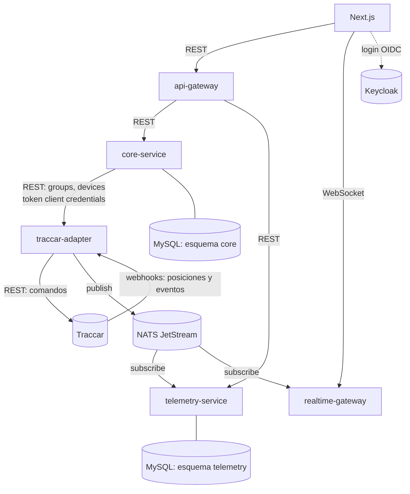

# Telemetry Platform — Arquitectura y conceptos

- Origen: *Telemetry Platform — Architecture Decisions & Concepts* (PDF, 2026-10-10), pasado a Markdown el
  2026-10-15 para versionarlo y revisarlo por PR. Este archivo es ahora la fuente; el PDF queda como histórico.
- Las diferencias con el PDF están en [§10](#10-cambios-respecto-al-documento-original) y lo que falta por definir
  en [§11](#11-pendiente-de-definir).

## 1. Resumen del proyecto
Plataforma **SaaS B2B multitenant de telemetría vehicular**, construida en solitario con microservicios elegidos
**deliberadamente como vehículo de aprendizaje**, no solo por coste. Clientes objetivo: dueños de flotas, empresas de
logística y de renta de vehículos, que ya pagan una mensualidad por este tipo de software. **Una empresa cliente = un
tenant**, tanto en el producto como en la infraestructura.

La plataforma se apoya en **Traccar** (rastreo GPS open source) y añade lo que Traccar no da:
- **Aislamiento multitenant**: un despliegue sirve a muchas empresas cliente.
- **Lógica de negocio por vertical** sobre los datos de ubicación:
  - **Viajes** (*travels*): pasajeros o rutas programadas.
  - **Órdenes** (*orders*): trabajos de entrega / logística.
  - **Rastreo genérico** de flota para todo lo demás.

## 2. Decisiones de un vistazo
| Área | Decisión | Por qué |
|------|----------|---------|
| Estilo de servicios | Microservicios completos (5 servicios) | Elección de aprendizaje: comunicación real entre servicios, aceptando más operación |
| Comunicación síncrona | REST (NestJS) | El patrón más simple; gRPC como ejercicio posterior |
| Comunicación asíncrona | NATS (JetStream) | Huella mínima (~15-20 MB), pub/sub y request/reply nativos, transporte de NestJS |
| Estructura interna | Hexagonal por servicio | Lógica de negocio aislada de la infraestructura; adaptadores intercambiables |
| Historial de ubicaciones | MySQL, tabla particionada por fecha | Sin escala confirmada: no adoptar una tercera tecnología de BD de forma especulativa |
| Multitenancy en Traccar | Un group de Traccar por tenant | Encaja con el modelo nativo de Traccar; se refuerza en la capa de aplicación, nunca se confía solo en él |
| Autenticación | Keycloak, un realm, groups por tenant | Más ligero que un realm por tenant; los realms se reservan para clientes de alto aislamiento |
| ORM | Prisma (core-service y telemetry-service) | Acceso tipado a MySQL |
| Despliegue | VM ARM gratuita de Oracle Cloud (docker-compose) + Next.js en Vercel | Máximo cómputo gratuito; el frontend en un CDN gratuito |

## 3. Arquitectura del sistema
Seis piezas: un par de cara al cliente (api-gateway, realtime-gateway), un núcleo de negocio (core-service) y un
pipeline de tres etapas que saca datos de Traccar y los empuja en tiempo real (traccar-adapter, NATS,
telemetry-service).

| Servicio | Repo / carpeta | Responsabilidad |
|----------|----------------|-----------------|
| **api-gateway** | `api-gateway` | Punto de entrada REST. Valida el JWT de Keycloak de cada petición, **resuelve el tenant** desde los claims y enruta a core-service o telemetry-service. Deliberadamente delgado: sin lógica de negocio. |
| **core-service** | `core-service` | Dueño del contexto de tenants y facturación: tenants, vehículos (vista de negocio: propiedad, plan, facturación), usuarios y la lógica de las verticales (viajes, órdenes). Separado de la telemetría a propósito: una caída de Traccar o un bug de procesamiento de ubicaciones no puede tumbar la facturación ni la gestión de tenants. Guarda el mapeo `tenant_id ↔ traccar_group_id` y `vehicle_id ↔ traccar_device_id`. |
| **traccar-adapter** | `traccar-adapter` | Único servicio que habla con Traccar. Ejecuta los comandos de core-service (groups, devices), recibe por webhook lo que Traccar reenvía, lo normaliza al formato de la plataforma y lo publica en NATS. Sin BD ni lógica de negocio (salvo el outbox de entrega, §10). |
| **telemetry-service** | `telemetry-service` | Se suscribe a NATS, resuelve el tenant por `groupId`, filtra ruido, escribe el historial de ubicaciones en su tabla MySQL particionada y **evalúa reglas de geocercas y alertas**. Responde consultas de historial. |
| **realtime-gateway** | `realtime-gateway` | Mantiene los WebSockets del frontend y se suscribe a NATS para **empujar ubicaciones y eventos en vivo** a los clientes conectados del tenant correcto. Separado de api-gateway porque los WebSockets son conexiones largas y con estado: reiniciarlo no debe afectar al tráfico REST. |

## 4. Patrones de comunicación
| Patrón | Entre | Por qué |
|--------|-------|---------|
| REST síncrono | api-gateway → core-service / telemetry-service; core-service → traccar-adapter | Pregunta directa que necesita respuesta inmediata |
| NATS JetStream (pub/sub, asíncrono) | traccar-adapter → telemetry-service, realtime-gateway | Un evento, varios consumidores independientes; el publicador no sabe ni espera quién escucha |
| Webhooks (push HTTP) | Traccar → traccar-adapter | Traccar reenvía posiciones y eventos en cuanto los recibe (*forwarding*) |

REST donde haga falta respuesta directa; convertir una llamada interna a gRPC es un buen ejercicio posterior.
Contratos publicados: [traccar-adapter `docs/contracts/`](https://github.com/RamonTec/traccar-adapter/tree/main/docs/contracts)
(OpenAPI de comandos y AsyncAPI de eventos).

## 5. Estructura interna: arquitectura hexagonal
Hexagonal (puertos y adaptadores) **dentro** de cada servicio, no entre servicios:
- **Dominio**: entidades y reglas sin dependencias de framework (p.ej. `GeofenceRule`).
- **Aplicación**: casos de uso que orquestan el dominio (p.ej. `ProcessLocationUpdateUseCase`).
- **Puertos**: interfaces de las que depende la aplicación (p.ej. `LocationRepositoryPort`).
- **Adaptadores**: implementaciones inyectadas (repositorio Prisma/MySQL, suscriptor NATS).

Cambiar el almacenamiento por una base de series temporales significa escribir otro adaptador; el dominio y los casos
de uso no cambian, y se prueban sin MySQL ni NATS reales.

**Bounded contexts (DDD)**: cada servicio tiene su propio modelo de las cosas reales. El "vehículo" de core-service
(propiedad, plan, facturación) y el de telemetry-service (mapeo de device, última posición) son modelos distintos a
propósito. En traccar-adapter solo existen **Device** y **Group**.

## 6. Estrategia de datos
- MySQL para el núcleo de negocio (esquema de core-service) y para el historial (esquema de telemetry-service):
  **esquemas separados** aunque compartan servidor; nunca comparten tablas ni migraciones.
- El historial vive en una tabla **particionada por fecha** (día o semana).
- La **BD de Traccar es un buffer efímero**, no una fuente de verdad: la telemetría llega a telemetry-service por NATS
  y se guarda allí, así que limpiar periódicamente la BD de Traccar (p.ej. cada 15 días) no pierde histórico.
- **TimescaleDB** (Postgres con joins contra datos relacionales) se revisará cuando haya números reales de escritura
  (vehículos × frecuencia de reporte × tenants).

## 7. Autenticación y multitenancy
- **Keycloak**, un realm (`telemetry`), con groups y roles por tenant. api-gateway valida cada token y resuelve el
  tenant desde sus claims. Un realm por tenant queda reservado para un futuro nivel de alto aislamiento.
- **Entre servicios**: token de Keycloak por *client credentials* con audiencia y roles por servicio destino
  ([PADR-002](decisions/0002-service-to-service-auth.md)).
- **Traccar**: un group por tenant con sus devices. core-service guarda los mapeos; la lógica de negocio, la
  facturación y la UI nunca dependen de los ids internos de Traccar.
- **Ni los groups de Traccar ni los de Keycloak son la frontera de seguridad por sí solos**: el aislamiento entre
  tenants se aplica de nuevo en la capa de aplicación, que es la que se controla y audita.

## 8. Despliegue y costes
- Todo el stack (Traccar, Keycloak, MySQL, NATS y los cinco servicios) en una **VM ARM Always Free de Oracle Cloud**
  con docker-compose, usando imágenes arm64. El frontend Next.js en el plan gratuito de **Vercel**.
- Aviso: Oracle redujo en 2026 el Always Free Ampere A1 de 4 OCPU / 24 GB a **2 OCPU / 12 GB**. Confirmar en la consola
  antes de aprovisionar.
- Entornos y forma de levantar el stack: [`../environments.md`](../environments.md) y el [README](../../README.md).

## 9. Conceptos y orden de estudio
Conceptos: stateless vs. stateful, microservicios, monolito modular (el camino no elegido), API gateway, WebSockets,
broker / pub-sub, tenant y multitenancy, hexagonal, bounded context, ORM, base de series temporales, idempotencia,
consistencia eventual, acoplamiento por red como nuevo modo de fallo, escalado horizontal.

Orden sugerido:
1. REST y módulos de NestJS (base de api-gateway y core-service).
2. Stateless vs. stateful y WebSockets (antes de realtime-gateway).
3. Pub/sub y NATS (publish, subscribe, request/reply).
4. Hexagonal: aplicada primero en traccar-adapter ✅.
5. Patrones de multitenancy (esquema compartido, esquema por tenant, BD por tenant) antes de diseñar el esquema MySQL.
6. Idempotencia y reintentos con fallos reales ✅ (traccar-adapter: comandos idempotentes, dedup, outbox).

## 10. Cambios respecto al documento original
| # | El PDF decía | Ahora |
|---|--------------|-------|
| 1 | traccar-adapter habla con la API REST/WS de Traccar y telemetry-service consume el *stream* REST/WS de Traccar | Traccar **empuja** posiciones y eventos al adapter por **webhooks** (*forwarding*); el adapter usa REST solo para comandos. telemetry-service **solo lee de NATS**, nunca habla con Traccar. |
| 2 | traccar-adapter no guarda nada | Tiene un **outbox local** solo mientras NATS no está disponible (traccar-adapter ADR-0007): ninguna caída de NATS pierde datos. |
| 3 | — | **Dead-letter** (`telemetry.deadletter.traccar`): nada se descarta en silencio; telemetry-service puede guardarlo para análisis. |
| 4 | — | **Autenticación entre servicios** con *client credentials* (PADR-002), además de la de usuarios. |
| 5 | Limpiar la BD de Traccar cada ~15 días | Se mantiene. Si se implementa la reconciliación de traccar-adapter (spec 011, diferido), esa limpieza fija su ventana máxima de recuperación. |
| 6 | Nombres core-service / realtime-gateway | Confirmados como canónicos (§12); las carpetas `api-core` y `ws-gateway` se renombraron. |
| 7 | — | Decisiones de plataforma en [`decisions/`](decisions/) (PADR-001…003, antes ADR-0002…0004 de traccar-adapter). |

## 11. Pendiente de definir
- **Facturación**: planes, unidad de cobro y proveedor de pagos.
- **Requisitos de cada vertical**: viajes, órdenes y rastreo genérico.
- **Ciclo de vida del GPS**: baja y reemplazo (asignación y alta resueltas en §12; un device nunca cambia de group;
  un IMEI reutilizado es un device nuevo).
- **Alertas y geocercas**: quién las define (core-service) y quién las evalúa (telemetry-service).
- **Resolución `groupId → tenant`** en telemetry-service: llamada a core-service por evento o caché local sincronizada
  por eventos (Q2 del planning de traccar-adapter).
- **Imágenes arm64** para la VM de Oracle (build en la VM o multi-arch en CI) y **MySQL** en el stack.

## 12. Decisiones del descubrimiento de core-service
| Fecha | Tema | Decisión |
|-------|------|----------|
| 2026-10-15 | Nombres | **core-service** y **realtime-gateway** en repos, compose, Keycloak y docs. |
| 2026-10-15 | Multitenancy en MySQL | **Esquema compartido con `tenant_id`** en cada tabla de negocio; aislamiento obligatorio en la capa de aplicación (todo repositorio filtra por tenant). Esquema o BD por tenant quedan para un futuro nivel de alto aislamiento. |
| 2026-10-15 | Roles dentro de un tenant | **Administrador del tenant** (usuarios, vehículos, GPS, suscripción), **operador/despachador** (mapa, historial, viajes y órdenes), **solo lectura** (consulta) y **conductor** (sus viajes/órdenes asignados). |
| 2026-10-15 | Alta de tenants | **Manual por el operador de la plataforma** (superadmin), que crea el tenant y su primer administrador. Autoservicio, más adelante. |
| 2026-10-15 | Vehículo ↔ GPS | **1 a 1, reasignable dentro del tenant**: un vehículo tiene como máximo un GPS activo; el GPS puede pasar a otro vehículo del mismo tenant (mismo device y group en Traccar). core-service guarda el **historial de asignaciones con vigencia** para atribuir cada posición al vehículo correcto. |
| 2026-10-15 | Alta de GPS | La hace el **administrador del tenant** con el IMEI (flujo `POST /devices` de traccar-adapter). |
| 2026-10-15 | Conductor | **Entidad propia de la flota** (nombre, licencia, teléfono) asignable a vehículos, viajes y órdenes; **usuario opcional** con rol conductor si necesita entrar a la app. |
| 2026-10-15 | Verticales | **Por plan**: rastreo genérico siempre incluido; viajes y órdenes se activan según el plan; un tenant puede tener ambas. |

