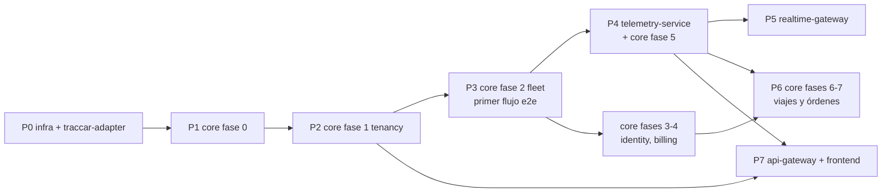

# Roadmap de plataforma

- Estado: **borrador para revisión** (2026-10-18).
- Qué es: el orden de construcción de **toda** la plataforma y las dependencias **entre servicios**. El detalle de
  cada servicio (módulos, fases, requisitos, specs) vive en su planning; aquí solo se enlaza.
- Fuentes: [architecture.md](architecture.md) (§3 servicios, §11 pendientes, §12 decisiones) y los plannings de cada
  servicio. Los enlaces a otros repos son relativos: asumen los repos clonados uno junto a otro.

## Servicios
| Servicio | Responsabilidad (resumen de §3) | Planning | Estado |
|----------|----------------------------------|----------|--------|
| **telemetry-infra** | Stack común: compose, Traccar, NATS, Keycloak (realm, clients, PADR-004), MySQL (`core`, `telemetry`) | [README](../../README.md) · [entornos](../environments.md) | Operativo en local |
| **traccar-adapter** | Único que habla con Traccar: groups, devices, webhooks → NATS | [planning](../../../traccar-adapter/docs/product/planning.md) · [specs](../../../traccar-adapter/docs/specs/ROADMAP.md) | **v1 terminada** (001–016 `done`; 011 reconciliación diferida) |
| **core-service** | Tenants, usuarios, flota, facturación, verticales; mapeo negocio ↔ Traccar | [planning](../../../core-service/docs/product/planning.md) · [specs](../../../core-service/docs/specs/ROADMAP.md) | **Fase 0 en curso** (001 implementándose; 002–006 aprobados) |
| **telemetry-service** | Historial de posiciones, `group → tenant`, geocercas y alertas | _sin planning_ | Esqueleto |
| **realtime-gateway** | WebSockets: posiciones y eventos en vivo por tenant | _sin planning_ | Esqueleto |
| **api-gateway** | Entrada REST: JWT, tenant y enrutado | _sin planning_ | Esqueleto |
| **frontend** (Next.js) | App web (`web-app` en Keycloak) | _sin repo_ | — |

## Fases de plataforma
Cada fase de plataforma se cierra con un resultado **observable de punta a punta**. Las columnas "fase del servicio"
remiten a la numeración del planning de ese servicio.

| # | Resultado al cerrarla | Servicios y fase de cada uno | Necesita |
|---|-----------------------|------------------------------|----------|
| **P0** | Traccar → NATS funciona con IMEIs de prueba | telemetry-infra; traccar-adapter v1 | — |
| **P1** | core-service desplegable, con auth de usuarios y BD con aislamiento | core-service **fase 0** (foundation) | P0 (Keycloak y MySQL de telemetry-infra) |
| **P2** | El operador da de alta un tenant y existe su group en Traccar | core-service **fase 1** (tenancy) | P1; traccar-adapter `POST /groups` (hecho) |
| **P3** | **Primer flujo de punta a punta**: un GPS registrado y asignado a un vehículo reporta y llega a NATS | core-service **fase 2** (fleet) | P2; traccar-adapter `POST /devices`, disable/enable (hechos) |
| **P4** | Las posiciones se guardan atribuidas a tenant y vehículo, con historial consultable | telemetry-service (planning + fases que defina); core-service **fase 5** (telemetry-mapping), diseñadas juntas | P3; decisiones D1 y D3 |
| **P5** | El frontend ve la flota en vivo | realtime-gateway | P4 (misma resolución `group → tenant`) |
| **P6** | Viajes y órdenes v1 | core-service **fases 6 y 7** | P4 (recorrido real; geocercas, D2) y core-service fase 4 (acceso por plan) |
| **P7** | Frontend publicado detrás de api-gateway | api-gateway; frontend | Las APIs que consuma el frontend (core-service desde P2, telemetry-service desde P4) |

**En paralelo, sin bloquear la cadena:** core-service **fase 3** (identity) y **fase 4** (billing) pueden avanzar
desde P2/P3 mientras se construye telemetry-service. api-gateway puede empezar en cuanto haya una primera pantalla.

## Dependencias entre servicios
| Consumidor | Proveedor | Qué usa | Contrato | Disponible |
|------------|-----------|---------|----------|------------|
| core-service | traccar-adapter | Crear group, registrar device, disable/enable (S2S, client credentials) | traccar-adapter `docs/contracts/` (OpenAPI), PADR-002 | Sí |
| core-service | Keycloak | Validar JWT de usuario (`tenant_id`, roles) | PADR-004 | Sí |
| core-service | Keycloak Admin API | Crear usuarios del tenant | — (se define en core-service fase 3) | Fase 3 |
| telemetry-service | traccar-adapter (NATS) | Eventos `TELEMETRY_EVENTS` / `TELEMETRY_DEADLETTER` | PADR-003, traccar-adapter AsyncAPI | Sí |
| telemetry-service | core-service | `group → tenant`, `device + instante → vehículo` | Por definir (D1) | P4 |
| realtime-gateway | traccar-adapter (NATS) | Posiciones y eventos en vivo | PADR-003 | Sí |
| realtime-gateway | core-service o telemetry-service | `group → tenant` para filtrar por tenant | Por definir (D1) | P5 |
| core-service | telemetry-service | Recorrido real (viajes), geocercas (órdenes) | Por definir (D2) | P6 |
| api-gateway | core-service, telemetry-service | Rutas REST y reenvío del JWT | OpenAPI de cada servicio; PADR-001, PADR-004 | P7 |

## Decisiones de plataforma pendientes
Afectan a más de un servicio: cada una se resuelve como **PADR** antes de la fase que bloquea.

| ID | Decisión | Opciones | Bloquea | Origen |
|----|----------|----------|---------|--------|
| D1 | Cómo conocen telemetry-service y realtime-gateway el mapeo `group → tenant` y `device → vehículo` | Eventos de dominio de core-service en NATS + copia local (recomendada) / llamada a core-service por evento | P4, P5 | architecture §11; core-service planning fase 5; traccar-adapter Q2 |
| D2 | Dueño de geocercas y reglas de alerta | core-service y sincroniza por eventos / telemetry-service | P4 (diseño), P6 | architecture §11 |
| D3 | Llamadas S2S entrantes a core-service (tokens de servicio) | Extender PADR-002 a core-service como proveedor | P4 | core-service fase 0 (diferido) |
| D4 | Imágenes arm64 para la VM de Oracle | Multi-arch en CI / build en la VM | Primer despliegue en la VM | architecture §11; core-service 002 verifica que compila |
